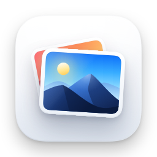

<p align="center">
  
</p>

<h1 align="center">Blickli</h1>

<p align="center">
  A native macOS image browser and slideshow viewer built in Rust.
</p>

<p align="center">
  macOS 27+ (Apple Silicon) &middot; Native AppKit &middot; MIT License
</p>

---

Blickli browses folders and mounted volumes directly without importing photos
into a managed library. It supports JPEG, PNG, HEIC/HEIF, GIF and WebP
(including animations), TIFF, BMP, AVIF, and JPEG XL via macOS Image I/O.

For videos, see [Flickli](https://github.com/robchiral/Flickli), the companion
video player for sorting clips.

## Highlights

- **Fast on large folders.** Parallel directory walkers use macOS's
  `getattrlistbulk` syscall to read names, sizes, and timestamps inline without
  per-file `stat` overhead. Thumbnails decode on a viewport-prioritized worker
  pool (256 MB LRU cache), and live filesystem monitoring tracks disk changes
  without rescanning.
- **GPU-accelerated slideshows.** Slides render with Core Animation (`CALayer`)
  transforms and trilinear filtering, so zooming (up to 16×), panning, rotating,
  and flipping run on the GPU without redrawing bitmaps. A dedicated decode
  thread and 512 MB LRU cache keep stepping smooth across Retina displays.
- **Offline AI upscaling.** Local 2× and 4× super-resolution runs on Apple
  Silicon through Core AI using overlapping tiles, feathered seam blending, and
  alpha preservation, with interactive split-wipe and side-by-side comparison
  before saving.
- **Multithreaded compression.** Shrink individual images (`⇧⌘K`) or entire
  folder trees (**Compress Folder…**) under a target size cap (0.5–10 MB) across
  parallel workers. Spatial downscaling at high quality runs before dropping
  encoder quality, keeping EXIF metadata and RGB ICC profiles intact.
- **Safe editing and file workflows.** Lossless EXIF-tag rotation and horizontal
  flip (JPEG, HEIC/HEIF, PNG, TIFF), interactive crop, natural and EXIF-date
  sorting, filename filtering (`⌘F`), EXIF inspector (`⌘I`), quick move/copy with
  repeat-last-destination, Finder **Open With** support, and Trash-backed undo
  (`⌘Z` / `⇧⌘Z`).
- **Native and private.** Built on AppKit (`objc2`), Image I/O, and Core
  Animation with a small Swift Core AI bridge. No Electron or telemetry.

## Building from Source

Requires **macOS 27+** on Apple Silicon, Xcode Command Line Tools
(`xcode-select --install`), and a Rust toolchain ([rustup](https://rustup.rs)).

```bash
git clone https://github.com/robchiral/Blickli.git
cd Blickli

./scripts/make-app.sh               # builds, signs, and installs to /Applications/Blickli.app
open /Applications/Blickli.app
```

Run `./scripts/make-dmg.sh` to pack `target/Blickli-<version>.dmg`. Preferences
live under `local.blickli`. Signing auto-selects a Keychain certificate
(`Blickli Local`, `Apple Development`, or `Developer ID Application`), respects
`CODESIGN_IDENTITY`, or falls back to ad-hoc (`-`).

## Local AI Upscaling

Model weights are not bundled in the repository. Download
[SwinIR-L real-world ×4 for Core AI](https://huggingface.co/arraypress/upscale-swinir-l-real)
(`swinir-l-real-x4-128-float16.aimodel`, Apache-2.0) — or use any fixed-tile RGB
`.aimodel` (float16/float32, NCHW/NHWC/CHW/HWC):

```bash
hf download arraypress/upscale-swinir-l-real --local-dir ./upscale
# or: git clone https://huggingface.co/arraypress/upscale-swinir-l-real upscale
```

Point **Blickli › Settings › General › Upscaling** at that folder, then press
`u` in a slideshow or `⌘U` in the grid.

## Shortcuts

All 52 menu and slideshow shortcuts can be customized in **Settings ›
Shortcuts**; press `h` in a slideshow for the live reference.

| Context | Key Actions |
| --- | --- |
| **Browse** | `Return` / `⌘Y` slideshow · `⌘F` filter · `⌘I` info · `⌘⌫` Trash · `⇧⌘M` / `⌃⌘M` move / repeat · `⇧⌘C` / `⌃⌘C` copy / repeat · `⌘Z` undo |
| **Slideshow** | `←` / `→` or scroll step · `Space` play/pause · `+` / `-` / `=` / `*` zoom · `i` / `I` / `p` overlays · `q` / `Esc` close |
| **Edit** | `r` / `R` (`⌘]` / `⌘[`) rotate · `f` (`⇧⌘F`) flip · `c` (`⌘K`) crop · `u` (`⌘U`) upscale · `⇧⌘K` compress |

## Development

- `blickli-core`: folder scanning (`getattrlistbulk`), sorting, transfers, undo
  history, playlists, and decode workers.
- `blickli`: AppKit UI (`objc2`), Image I/O, Core Animation slide rendering,
  batch compression, and the Swift Core AI bridge.

```bash
cargo test --workspace                                            # unit tests
cargo run --release -p blickli-core --example scan_bench -- <dir> # scan benchmark
swift scripts/make-icon.swift                                     # regenerate app icon
```

End-to-end tests open windows and move temporary fixture copies to Trash:

```bash
sh scripts/make-fixture.sh ~/blickli-e2e-fixture
BLICKLI_E2E=1 cargo run -p blickli --features e2e -- ~/blickli-e2e-fixture
```

## Credits & License

Blickli is derived from [wêne](https://github.com/shaho/wene) by Shaho Toofani,
a port of [Phoenix Slides](https://blyt.net/phxslides/). Licensed under the MIT
License; see [LICENSE](LICENSE).
